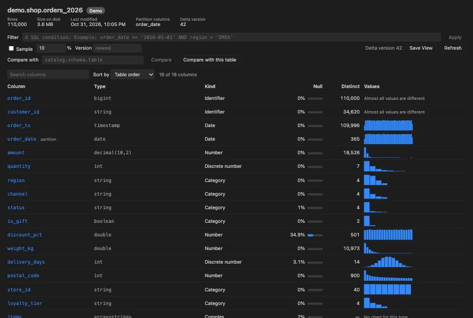
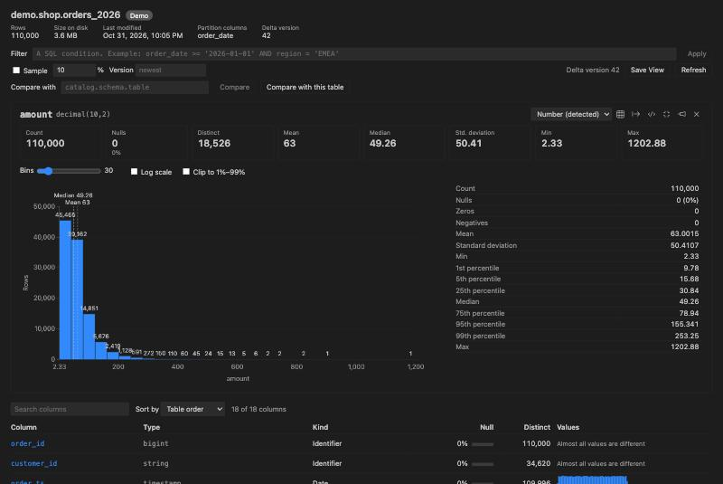
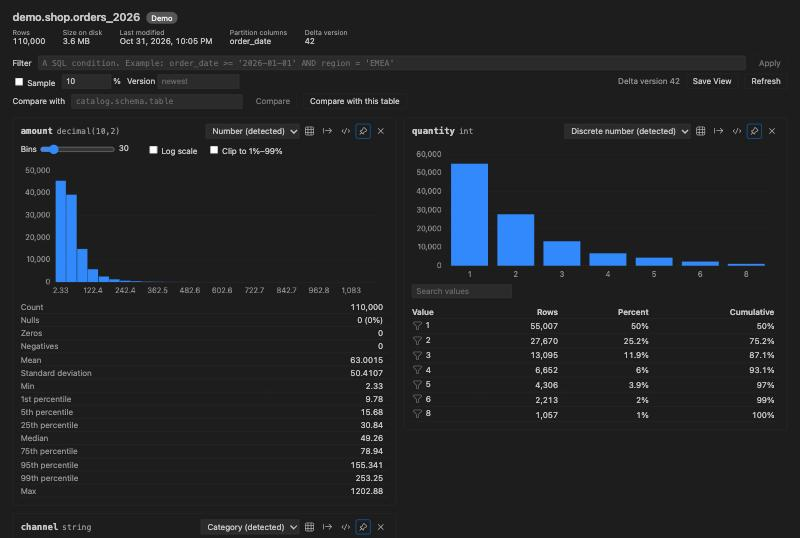
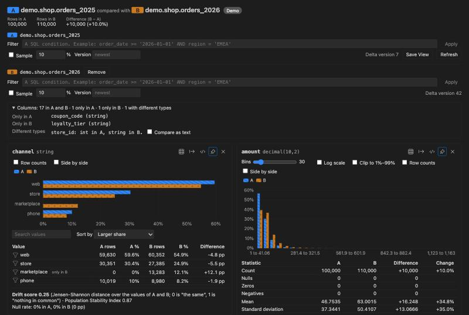
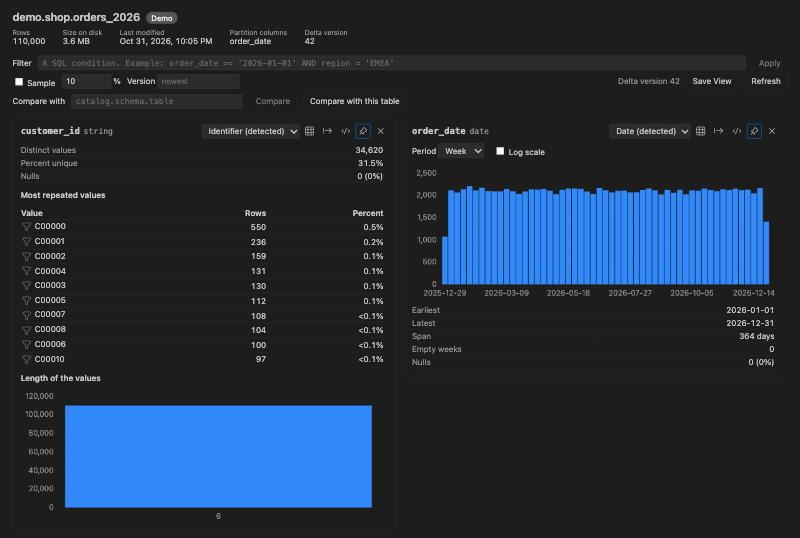
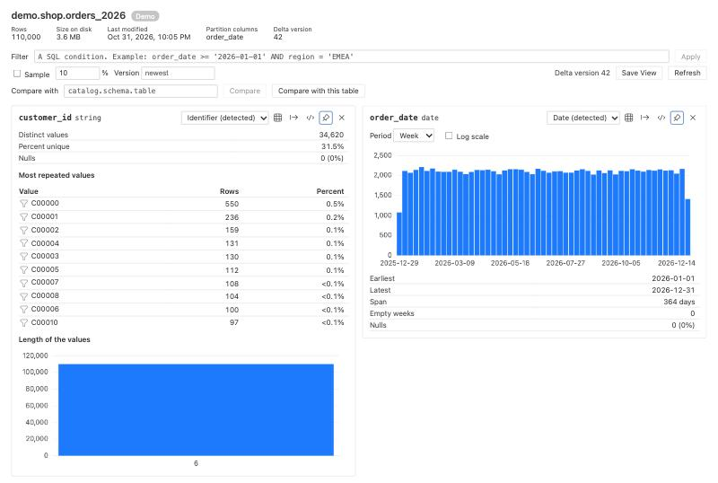
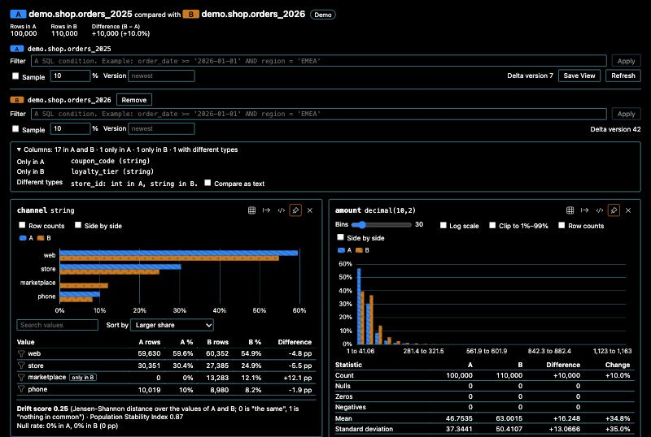

# Databricks Source Notebooks

**Summary:** This VS Code extension opens a Databricks `.py` notebook file as
a notebook. It runs each cell on your Databricks cluster. It saves the file in
the same `.py` format that Databricks uses, so your git diffs stay small.

**Status:** Prototype. The tests use a fake Databricks server. No person has
run the extension on a real cluster. See
[Things that are not tested](#things-that-are-not-tested).

## What the extension does

Your team saves notebooks as `.py` files like this one:

```python
# Databricks notebook source
# MAGIC %md
# MAGIC # Sales report

# COMMAND ----------

# MAGIC %run ./helpers/setup

# COMMAND ----------

# MAGIC %sql
# MAGIC select region, sum(amount) from sales group by region

# COMMAND ----------

df = spark.table("sales")
display(df)
```

Without the extension, VS Code shows this file as text. With the extension:

- **You see a notebook.** The file above opens as four cells: a title, a
  `%run` cell, an SQL cell and a Python cell. Each result shows below its cell.
- **The cluster runs the cells.** `spark`, `dbutils` and `display()` work as
  they do in Databricks, because the code runs in the same place. Your
  computer runs no notebook code. You do not need Databricks Connect.
- **`%run` works.** `%run ./helpers/setup` runs the file `helpers/setup.py`
  from your disk. That file can contain `%run` and `%sql` cells.
- **The file stays the same.** If you change one cell and save, git shows a
  change in that cell only. The extension does not save results in the file.
- **Copilot can use the notebook.** Copilot agent mode can add a cell, run a
  cell and read the result. Copilot can also edit the `.py` file as text.

## Install the extension

1. Get the packages that the build uses. You need Node.js 22 or later for
   this step and the next step.

   ```bash
   npm install
   ```

2. Build the install file:

   ```bash
   npm run package
   ```

3. Install it in VS Code:

   ```bash
   code --install-extension dbx-notebook-0.2.0.vsix
   ```

A computer that only installs the `.vsix` file does not need Node.js. To try
the extension without a Databricks workspace, see
[test/README.md](test/README.md).

## Connect to your workspace

The extension needs three things: the URL of your workspace, a login and a
cluster. For each one, it looks in the numbered places below, starting at 1.
It uses the first value that it finds.

| The extension needs | Where it looks |
|---|---|
| Workspace URL | 1. Setting `dbxNotebook.host`. 2. Variable `DATABRICKS_HOST`. 3. The file `.databricks/.databricks.env` in your project. 4. Your profile in `~/.databrickscfg`. |
| Login | 1. Variable `DATABRICKS_TOKEN`. 2. The `token` in your profile. 3. The command `databricks auth token`. |
| Cluster | 1. The cluster that you selected with "Select Cluster". 2. Setting `dbxNotebook.clusterId`. 3. Variable `DATABRICKS_CLUSTER_ID`. 4. The `cluster_id` in your profile. |

Three rules protect your token:

- The workspace URL must start with `https://`. The extension refuses
  `http://`, because `http://` sends your token as plain text.
- The extension uses the `token` of a profile only if the `host` of that
  profile is the same workspace URL. Example: your profile is for workspace A,
  and the project names workspace B. The extension does not send the token of
  workspace A to workspace B. It asks `databricks auth token` for a token for
  workspace B.
- The extension is off in a project that you did not trust (VS Code
  "Restricted Mode").

VS Code remembers one selected cluster for each project folder. If a VS Code
window has two project folders, each folder can use a different cluster.

If you use the official Databricks extension in the same project, you
probably do not need to set anything. The official extension writes
`.databricks/.databricks.env`, and it installs the `databricks` command.

The cluster must be an all-purpose cluster, and it must run before you run a
cell. The extension does not start a cluster.

## Use the notebook

1. Open a notebook `.py` file. The file opens as a notebook if its first line
   is `# Databricks notebook source`.
2. Run a cell. The first cell is slow, because the cluster must start a
   session for the notebook.
3. If the extension asks for a cluster, select your cluster from the list.

More things that you can do:

| To do this | Do this |
|---|---|
| See the file as text | Right-click the tab, select "Reopen Editor With...", then "Text Editor". |
| Go back to the notebook | Click the notebook button at the top right of the text editor. |
| Change the language of a cell | Click the language name at the bottom right of the cell. |
| Delete all variables on the cluster | Click "Reset Execution Context" in the notebook toolbar. |
| Use a different cluster | Click "Select Cluster" in the notebook toolbar. |
| Stop a cell | Click the stop button of the cell. |

If Databricks does not answer a request in 30 seconds, the cell stops with an
error, and the extension tells the cluster to cancel the command. If the
cluster does not get that message, the command can continue. Click "Reset
Execution Context" to stop it.

A cell keeps its language when you replace its text. If you paste Python into
an SQL cell, the cluster reports an SQL error. Change the language of the cell
to Python first.

## Look at a table

**Summary:** The command "Visualize Table" opens a page that shows each
column of a Databricks table: its type, how many rows are null, how many
different values it has, and charts of its values. Databricks computes all
numbers. The extension never downloads the rows of the table.

No person has run this part on a real workspace. All its tests use fake
servers and the demo tables. [docs/table-viz-design.md](docs/table-viz-design.md)
lists the decisions and the things that a real workspace must confirm.
[docs/table-viz-how-it-works.md](docs/table-viz-how-it-works.md) explains
the code.



To try it without a workspace, run "Databricks Notebook: Visualize Table"
and type `demo.shop.orders_2026`.

### Select the login and the compute

Run "Databricks Notebook: Select Profile and Compute for Tables". The first
list shows the logins that you can use:

| Entry in the list | What it uses |
|---|---|
| Notebook connection | The workspace of the notebooks. See [Connect to your workspace](#connect-to-your-workspace). |
| The name of a profile | That profile in `~/.databrickscfg`. If the profile has no `token` line, log in with `databricks auth login --profile <name>`. |
| A workspace URL | A token that you typed before. VS Code keeps it in its secret store, not in a file. |
| Demo | Two demo tables, `demo.shop.orders_2025` and `demo.shop.orders_2026`. No workspace and no login. |
| Type a workspace URL and a token… | Asks for the URL and a personal access token. |

The second list shows the SQL warehouses and the all-purpose clusters of
the workspace, with their state. The status bar then shows the login and the
compute. Click it to select a different one.

If the warehouse or the cluster is stopped, the extension asks before the
first query starts it. Compute that runs costs money, and a cluster can take
several minutes to start.

#### Set up a login

Use one of these four methods.

**A profile with a browser login (OAuth).** Use this if your company does
not permit personal access tokens.

1. Install the Databricks CLI, or install the official Databricks extension,
   which contains the CLI.
2. Log in. The command opens your browser:

   ```bash
   databricks auth login --host https://adb-1234567890123456.7.azuredatabricks.net --profile work
   ```

3. Run "Select Profile and Compute for Tables" and select `work`.

The extension asks the CLI for a new token when the old one expires.

**A profile with a token.**

1. Add these lines to the file `~/.databrickscfg`:

   ```ini
   [work]
   host = https://adb-1234567890123456.7.azuredatabricks.net
   token = <your personal access token>
   ```

2. Run "Select Profile and Compute for Tables" and select `work`.

**Environment variables.**

1. Set `DATABRICKS_HOST` and `DATABRICKS_TOKEN` before you start VS Code.
2. Run "Select Profile and Compute for Tables" and select "Notebook
   connection".

**A workspace URL and a token that you type.**

1. Run "Select Profile and Compute for Tables" and select "Type a workspace
   URL and a token…".
2. Type the URL, then the token. VS Code keeps the token in the secret store
   of your operating system.

#### Set up the compute

**A SQL warehouse.** You need the "Can use" permission on the warehouse.
Select it in the second list. No more steps.

**An all-purpose cluster.** Select it in the second list. The first query
connects to the cluster. If the extension cannot find the ID of your
workspace, it asks one time for the "HTTP Path" of the cluster. You find it
in Databricks on the page of the cluster, below "Advanced options", then
"JDBC/ODBC".

A SQL warehouse is the better choice: it starts faster, and it needs no
extra software. The extension can use a cluster only if these three things
are true:

| Condition | Why |
|---|---|
| The access mode of the cluster is "standard" or "dedicated". | A cluster with "no isolation shared" cannot read Unity Catalog. |
| The cluster has Databricks Runtime 14.2 or later. | The queries use `IDENTIFIER()` and named parameters. |
| VS Code is a recent version. | The Databricks SQL driver needs Node.js 22.23.4, 24.22.1 or later, and VS Code contains its own Node.js. |

The list shows a cluster that does not meet a condition with the reason, and
you cannot select it.

### Open a table

| To do this | Do this |
|---|---|
| Open a table by its name | Run "Databricks Notebook: Visualize Table" and type `catalog.schema.table`. |
| Find a table | Open the view "Databricks Tables" in the Explorer. Open a catalog and a schema, then click a table. Click in the view and type to filter. |
| Keep a table at hand | Click the star on a table in the view. The table is then below "Favorites". |
| Open a table from code | In a `.sql` or `.py` file, right-click a name such as `main.sales.orders` and select "Visualize Table Under Cursor". |

The view reads the catalog with the REST API. It never starts a warehouse.

### Use the board



Click the row of a column to open its detailed view. The detailed view uses
the full width of the board. It shows:

- **A row of large numbers:** the facts that you look for first. For a
  number column, these are the count, the nulls, the distinct count, the
  mean, the median, the standard deviation, the minimum and the maximum.
- **A large chart** with a title on each axis and a number on each bar. The
  histogram of a number column also has a line at the mean and a line at
  the median.
- **The tables of the column,** next to the chart.

The chart and the tables fit the column:

| Column | The card shows |
|---|---|
| A number with many values | A histogram, and the mean, the median and other statistics. |
| A number with few values, or a category | One bar for each value, and a table of the values with their counts. |
| An ID | The number of different values, the values that repeat, and the lengths of the values. |
| A date | The number of rows in each day, week, month or year. |

On each card you can change how the feature reads the column (for example, a
postal code is a category, not a number), show the chart as a table, and
show the SQL behind the numbers.

To look at two or more columns together, pin a card. A pinned card becomes
small and stays on the board when you open the next column. Small cards sit
side by side:



The button with the screen icon changes a card from small to detailed and
back.

While a query runs, the board keeps the old numbers on the screen and shows
them dimmed. A thin line moves along the top of a card that waits for new
numbers. When the new numbers arrive, the bars of a chart move to their new
heights. If your operating system is set to "reduce motion", the board
shows no animation.

Above the cards:

| Control | What it does |
|---|---|
| Filter | Type a SQL condition, for example `order_date >= '2026-01-01' AND region = 'EMEA'`. Databricks checks the condition before the board uses it. |
| Sample | Read a part of the rows only. This is faster and cheaper. All counts are then estimates, and each card shows "Sampled". |
| Refresh | Run all queries again. |
| Cancel | Stop the queries that run now. The extension also stops the query of a card that you close. |

"≈" before a number shows that Databricks estimated it.

### Filter with a click

Click a bar of a chart to keep only the rows of that bar. On a histogram or
a date chart, you can also drag across some bars to keep a range. The filter
shows as a chip above the cards, for example `channel = store` or
`amount: 42.36 to 242.45`. All cards then show the filtered rows.

Each chip has a button that removes it. Two or more chips combine with AND.
To do the same with the keyboard, show the chart as a table: each row has a
filter button.

### Save, copy and reuse

The "Save or copy" button of a card has these commands:

| Command | What you get |
|---|---|
| Save chart as PNG, Save chart as SVG | An image file of the chart. |
| Copy chart | The chart as an image on the clipboard. |
| Save tables as CSV, Copy tables | The tables of the card as CSV text. Numbers have no separators between groups of digits. |
| Open SQL in Editor | The SQL of the card in a new editor, with the values in the text, so that you can run it in Databricks. |

"Save View" writes the board to a file with the extension `.tableviz.json`.
The file holds the datasets, the filters, the open cards and their settings.
It holds no data and no token, so you can commit it or send it to a
colleague. Open the file in VS Code to get the board again; the board runs
its queries again.

A filter in such a file is SQL, and it runs with your Databricks login.
Thus, when you open a view that you did not save yourself, the board first
shows the datasets and the filters, and it runs no query until you click
"Run the Queries". In a project that you did not trust, VS Code does not
start the extension.

### Compare two tables

Compare mode puts a second dataset, B, next to the first dataset, A. It
compares each column whose name is in A and in B.



| To do this | Do this |
|---|---|
| Compare two tables | Run "Databricks Notebook: Compare Tables", or click the compare icon on a table in the view "Databricks Tables". You can also type the second table in the box "Compare with" on a board. |
| Compare one table under two filters | Click "Compare with this table" on the board. Then type a different filter for A and for B. |
| Compare one table at two Delta versions | Click "Compare with this table". Then type a version number, or a date and time, in the box "Version" of B. |

The board then shows these things:

- **The columns.** Which columns are in A and in B, which are in one
  dataset only, and which have a different type. If two types are both
  numbers, the board compares the values as numbers. For other type
  differences, select "Compare as text" to compare the column.
- **One row for each column**, with the percent of nulls, the distinct count
  and the mean for A and for B, and the drift score. The rows with the
  highest drift score come first.
- **A detail card** when you click a column. Its chart shows A and B for the
  same bins, values or periods. The tables show A, B and the difference.

The chart of a card shows the percent of the rows of each dataset, because A
and B usually have different sizes. Select "Row counts" to see counts, and
"Side by side" to see one chart for each dataset.

**The drift score** tells how different a column is in A and B. It is the
Jensen-Shannon distance: 0 means that the column is the same, 1 means that
A and B have nothing in common. For a category, the board computes it over
the values. For a number or a date, it computes it over 10 bins that each
contain one tenth of the values of A. The score ranks the columns. It is
not a test of significance: with millions of rows, each small difference
would be "significant".

A card also shows the Population Stability Index, and the change of the null
rate on its own line.

A change of B does not run the queries of A again. One exception: a
histogram with shared bins, because its bins depend on the range of A and B
together.

### What the feature sends to Databricks

- Only `SELECT` and `DESCRIBE` statements. Each statement returns counts and
  statistics, never rows of the table.
- Each statement has the tag `feature` = `table-viz`, so that an
  administrator can find these queries in the query history.
- For a Delta table, all queries read the version that the table had when
  you opened the board. The cards then agree while a job writes to the table.
- Before the first query on a table larger than 100 GB, the board asks. You
  can use a sample or a filter. In compare mode, the board asks for each
  dataset that is larger than 100 GB.
- The extension runs 4 queries at the same time at most on a warehouse, and
  2 on a cluster. It cancels a query after 5 minutes. The settings change
  these numbers.
- On a cluster, the extension uses the Databricks SQL Driver for Node.js. It
  turns off the usage data that the driver sends by default, and it does not
  let the driver download results from cloud storage. The extension talks to
  your workspace URL only.

## Magic commands

| First line of the cell | What the extension does |
|---|---|
| `%md` | Shows the cell as text. Does not run it. |
| `%sql`, `%scala`, `%r` | Sends the cell to the cluster in that language. |
| `%sh` | Runs the cell in `bash` on the driver of the cluster. |
| `%run ./other` | Runs `other.py` from your disk in the session of this notebook. |
| `%python` | Runs the other lines of the cell as Python. |
| `%pip`, `%fs` and all others | Sends the cell to the cluster without a change. |

## Settings

| Setting | Default | What it does |
|---|---|---|
| `dbxNotebook.autoOpen` | on | Opens Databricks `.py` files as notebooks. Set it to off to open them as text. |
| `dbxNotebook.host` | empty | The URL of your workspace. Example: `https://adb-123.azuredatabricks.net`. |
| `dbxNotebook.profile` | empty | The name of your profile in `~/.databrickscfg`. Empty uses `DEFAULT`. |
| `dbxNotebook.clusterId` | empty | The ID of your cluster. Example: `0101-123456-abcdefgh`. |
| `dbxNotebook.cliPath` | empty | The path of the `databricks` command. Empty uses the one from the official extension. |
| `dbxNotebook.tableViz.defaultBins` | 30 | The number of bins of a new histogram in "Visualize Table". From 5 to 200. |
| `dbxNotebook.tableViz.topValues` | 20 | The number of values in the bar chart of a category column. From 1 to 100. |
| `dbxNotebook.tableViz.warehouseId` | empty | The ID of the SQL warehouse for "Visualize Table". A warehouse or a cluster that you select from the list is used before this setting. |
| `dbxNotebook.tableViz.confirmComputeStart` | on | Ask before a query starts a stopped warehouse or cluster. |
| `dbxNotebook.tableViz.maxConcurrentQueries` | 0 | The largest number of queries that run at the same time. `0` means 4 on a warehouse and 2 on a cluster. |
| `dbxNotebook.tableViz.queryTimeoutSeconds` | 300 | The time limit of one query, in seconds. |
| `dbxNotebook.tableViz.largeTableWarningGB` | 100 | The board asks before the first full scan of a table that is larger than this size. |
| `dbxNotebook.tableViz.matchColumnsCaseSensitive` | off | Compare mode: match the column `Region` only with `Region`. If off, `Region` also matches `region`. |

## Limits

- The extension opens Python notebooks only. It does not open `.sql`,
  `.scala` or `.r` notebook files.
- `%run` accepts a path that starts from the folder of the notebook, such as
  `./helpers/setup` or `../common`. It does not accept a workspace path such
  as `/Repos/team/project/setup`.
- `%run` ignores values after the path. `%run ./setup $env="dev"` runs
  `setup.py` but does not set `env`.
- The extension does not work with serverless compute or SQL warehouses.
- The extension shows no boxes for `dbutils.widgets` values.

## Things that are not tested

A real cluster must confirm each item in this list:

- All three login methods.
- A Personal Compute cluster.
- `%sql`, `%scala` and `%r` cells in the same session as Python cells.
- The results of `display(df)`, `displayHTML()` and plots.
- `%pip` and `%fs`.
- `dbutils.widgets` and `dbutils.notebook`.
- Text that shows while a cell runs. The extension shows such text if the
  cluster reports it. We do not know if a real cluster reports it.
- Copilot agent mode.

For "Visualize Table", a real workspace must confirm these items:

- Each SQL statement, on a SQL warehouse and on a cluster. The main risks
  are `IDENTIFIER(:name)` for a column, and a Delta version after
  `IDENTIFIER(:name)`.
- The requests that list SQL warehouses, clusters, catalogs, schemas and
  tables. I wrote their field names from memory.
- The Databricks SQL driver with a real cluster, and the minimum runtime
  14.2.
- The login with a profile and `databricks auth token`.
- The questions "Start the warehouse?" and "Start the cluster?".

`npm run test:live` tests most of these items. See
[test/README.md](test/README.md).

## Themes and the keyboard

The board uses the colors of your VS Code theme: light, dark and high
contrast. Dataset A is blue and dataset B is orange on each chart, and the
bars of the two datasets have different patterns. You do not need to see the
difference between red and green.

| Dark | Light | High contrast |
|---|---|---|
|  |  |  |

You can reach each control with the Tab key. Each chart has a table with the
same numbers: select the table button of the card. A table row has a filter
button, which does what a click on a bar does.

## More documentation

| File | What it tells you |
|---|---|
| [docs/how-it-works.md](docs/how-it-works.md) | How the extension opens, saves and runs a notebook. Where each part is in the code. |
| [test/README.md](test/README.md) | How to run the tests and the demo. What the fake Databricks server does. |
| [docs/table-viz-how-it-works.md](docs/table-viz-how-it-works.md) | How "Visualize Table" gets a number from Databricks to a chart. Where each part is in the code. |
| [docs/table-viz-design.md](docs/table-viz-design.md) | The plan for the "Visualize Table" feature, its decisions, and what is not verified. |
| [CHANGELOG.md](CHANGELOG.md) | What changed in each version. |
